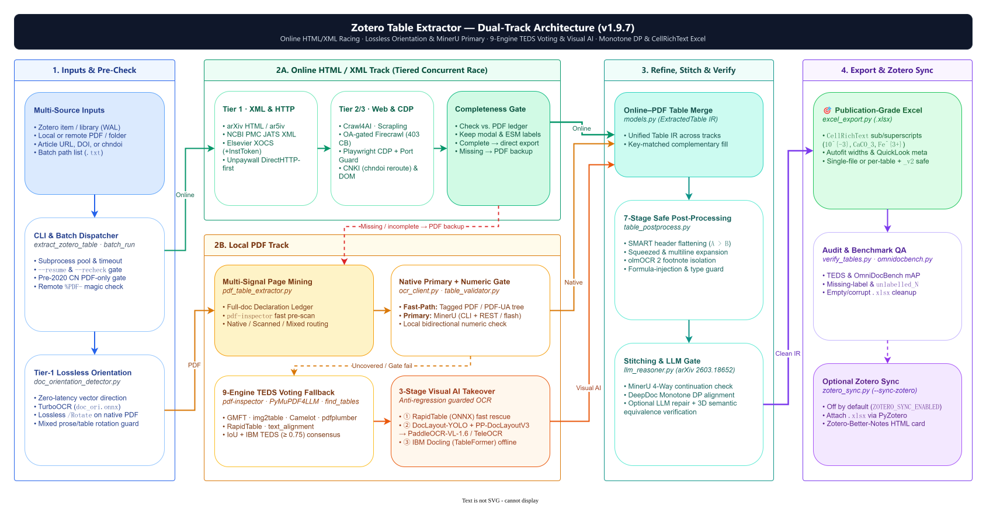
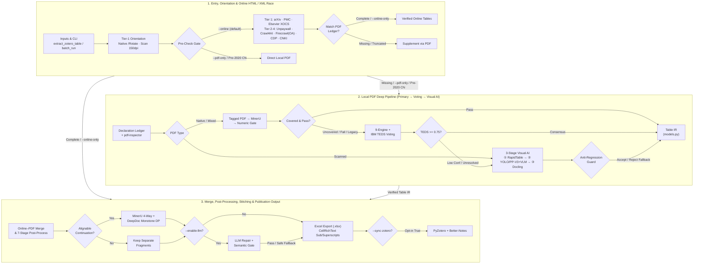

# 📊 Zotero Table Extractor

<p align="center">
  <a href="README.md"><b>English</b></a> | <a href="README.zh-CN.md">简体中文</a>
</p>

<p align="center">
  <b>End-to-End Intelligent Scientific Table Extraction System for Zotero, PDFs, and Academic Publishers</b><br/>
  Automatically locate, extract, verify, reconstruct, and export complex scientific tables from Zotero items, local or remote PDFs, journal web pages, and DOIs into publication-grade Excel (<code>.xlsx</code>) workbooks.
</p>

<p align="center">
  <a href="#-core-capabilities"></a>
  <a href="#2-native-pdf-primary-pipeline-9-engine-consensus--ibm-teds-arbitration"></a>
  <a href="#3-two-track-rotation-remediation--3-stage-visual-ai-takeover"></a>
  <a href="#-requirements--installation"></a>
  <a href="#-requirements--installation"></a>
  <a href="LICENSE"></a>
</p>

<p align="center">
  <a href="#-architecture--data-flow"></a>
</p>

---

## 📑 Table of Contents

- [💡 Overview](#-overview)
- [✨ Core Capabilities](#-core-capabilities)
  - [1. Online HTML/XML High-Fidelity Extraction (Tiered Concurrent Racing)](#1-online-htmlxml-high-fidelity-extraction-tiered-concurrent-racing)
  - [2. Native PDF Primary Pipeline, 9-Engine Consensus & IBM TEDS Arbitration](#2-native-pdf-primary-pipeline-9-engine-consensus--ibm-teds-arbitration)
  - [3. Two-Track Rotation Remediation & 3-Stage Visual AI Takeover](#3-two-track-rotation-remediation--3-stage-visual-ai-takeover)
  - [4. 7-Stage Safe Post-Processing & SMART Semantic Header Flattening](#4-7-stage-safe-post-processing--smart-semantic-header-flattening)
  - [5. Multi-Page Continuation Merging (MinerU 4-Way & DeepDoc Monotone DP)](#5-multi-page-continuation-merging-mineru-4-way--deepdoc-monotone-dp)
  - [6. OmniDocBench Standardization & LLM Semantic Equivalence Gate](#6-omnidocbench-standardization--llm-semantic-equivalence-gate)
  - [7. Publication-Grade Excel Export (CellRichText Sub/Superscripts)](#7-publication-grade-excel-export-cellrichtext-subsuperscripts)
  - [8. Full-Library Batch Concurrency & Industrial Robustness](#8-full-library-batch-concurrency--industrial-robustness)
  - [9. Optional PyZotero & Zotero-Better-Notes Ecosystem Sync](#9-optional-pyzotero--zotero-better-notes-ecosystem-sync)
- [🏗 Architecture & Data Flow](#-architecture--data-flow)
- [💻 Requirements & Installation](#-requirements--installation)
- [🔧 Configuration Guide](#-configuration-guide)
  - [1. Cross-Platform Interactive Setup Wizard (`setup_paths.py`)](#1-cross-platform-interactive-setup-wizard-setup_pathspy)
  - [2. Manual Configuration (`config.json`)](#2-manual-configuration-configjson)
  - [3. Environment Variables & Companion Credential Discovery](#3-environment-variables--companion-credential-discovery)
  - [4. Configuration Reference](#4-configuration-reference)
  - [5. Obtaining API Keys & CLI Tools](#5-obtaining-api-keys--cli-tools)
  - [6. Safe Self-Updating & Config Protection (`update.py`)](#6-safe-self-updating--config-protection-updatepy)
  - [7. Publisher & CNKI Login Wizard (`login.py`)](#7-publisher--cnki-login-wizard-loginpy)
- [🚀 Usage](#-usage)
  - [Single PDF Extraction](#single-pdf-extraction)
  - [Online Article URL / DOI Extraction](#online-article-url--doi-extraction)
  - [Directory & Path-List Batch Extraction](#directory--path-list-batch-extraction)
  - [Full Zotero Library Batch Extraction](#full-zotero-library-batch-extraction)
  - [AI Agent / MCP Orchestration](#ai-agent--mcp-orchestration)
  - [Output Verification & Cleanup](#output-verification--cleanup)
- [📂 Repository Structure](#-repository-structure)
- [🧪 Regression Testing & Benchmark Scope](#-regression-testing--benchmark-scope)
- [🙏 Acknowledgements & Referenced Projects](#-acknowledgements--referenced-projects)
- [📄 License & Disclaimer](#-license--disclaimer)

---

## 💡 Overview

Scientific tables—especially in earth sciences, geochemistry, materials science, chemistry, biology, and medicine—routinely feature **borderless three-line layouts, nested `rowspan`/`colspan` spanning headers, squeezed numeric cells, chemical formulas, sub/superscripts, $\pm$ tolerances, and multi-page continuation segments**. Single-tool extractors (e.g., standalone Camelot or raw OCR) frequently suffer from shifted columns, truncated bottom rows, dropped tables, or corrupted scientific notation.

**Zotero Table Extractor** solves this with a resilient, dual-track architecture:

1. **Online-First High-Fidelity Track**: Runs tiered concurrent racing across native structured sources (**arXiv HTML / ar5iv LaTeXML, NCBI PMC JATS XML, Elsevier XOCS XML**), publisher DOM adapters, **CNKI** (with `chndoi.org` dynamic rerouting), OA-gated **Firecrawl**, **Scrapling**, **Crawl4AI**, and **CDP-aware Playwright** (with `DevToolsActivePort` dynamic discovery and anti-bot Port Guard). Any missing or truncated tables are seamlessly supplemented by the local PDF pipeline and losslessly merged.
2. **Lossless Orientation & Structured PDF Primary Track**: Combines 0-latency vector text orientation checks with **TurboOCR (`doc_ori.onnx`)** for lossless `/Rotate` remediation on native PDFs (preserving vector text and structure trees). Routes native PDFs through **Tagged PDF / PDF/UA Structure Tree** fast-path → **MinerU Open API (CLI + REST dual-mode, `flash-extract`, DoH CDN self-healing)** → **Local Numeric Integrity Gate** → targeted **9-Engine Consensus Voting & IBM TEDS** topology arbitration.
3. **3-Stage Visual AI & Offline Takeover**: Recovers unresolved, scanned, or low-confidence pages via **RapidTable (ONNX)** → **DocLayout-YOLO + PP-DocLayoutV3** layout ensemble / **PP-StructureV3** cropping into **PaddleOCR-VL-1.6** or **TeleOCR (vLLM)** → **IBM Docling (TableFormer)** pure CPU/Metal offline fallback, strictly guarded by anti-regression quality checks.
4. **7-Stage Post-Processing, SMART Headers & Monotone DP Stitching**: Preserves MultiIndex hierarchies, flattens multi-level headers via **SMART** (`Category > Subcategory > Field [Unit]`), isolates **olmOCR 2-style footnotes**, escapes Excel formula injection, and stitches multi-page continuation tables via **MinerU 4-Way** criteria and **DeepDoc/MinerU 3-Way Monotone DP** column alignment.
5. **Semantic Gate, Rich-Text Excel & Zotero Sync**: Validates LLM table repairs via **LLM Semantic Equivalence (`arXiv 2603.18652`)**, renders native academic sub/superscripts (`10^{-3}`, `CaCO_3`, `Fe^{3+}`) via `openpyxl` `CellRichText`, and optionally attaches `.xlsx` files plus **Zotero-Better-Notes** HTML preview cards back to Zotero.

---

## ✨ Core Capabilities

### 1. Online HTML/XML High-Fidelity Extraction (Tiered Concurrent Racing)

*Default `race=True` executes tiered parallel racing; pass `--sequential` to use the sequential DAG.*

- **Authoritative Full-Text XML/LaTeXML Priority**:
  - **arXiv HTML / ar5iv (LaTeXML)**: Native structured HTML table extraction with zero OCR error.
  - **NCBI PMC Open Access JATS XML**: Direct NISO JATS XML parsing preserving full `rowspan`/`colspan`, nested sections, and footnotes.
  - **Elsevier XOCS XML**: Direct API access (`X-ELS-APIKey` + optional `X-ELS-InstToken`) with automatic PII-to-DOI resolution.
  - **Grace Window**: When non-authoritative HTTP channels return early while `ArxivHTML`, `NCBIPMC`, or `ElsevierXML` is still running, the race controller grants a bounded grace window so complete XML tables are never preempted by partial page snippets.
- **Broad Publisher DOM Coverage**: Tailored selectors and modal expansion for **Wiley, Springer/Nature** (including `idp.springer.com` institutional redirect recovery), **Taylor & Francis** (with CSV download support), **ACS, GeoSciWorld / Silverchair** (modal table expansion & deduplication), **MDPI, Copernicus XML, Frontiers, APS, IOP, OUP, Sage, De Gruyter, and Science**.
- **CNKI (China National Knowledge Infrastructure) Pipeline**: Races `Scrapling` and `Crawl4AI` before falling back to `PlaywrightCNKI` (automated human-like slider drag, persistent cookies, and dynamic `chndoi.org` / `chinadoi.cn` rerouting). Automatically skips web scraping for pre-2020 Chinese PDFs (`is_pre_2020_chinese_paper`) that lack HTML full text.
- **CDP Dynamic Port Discovery, Port Guard & Tab Concurrency (`cdp_detector.py`)**:
  - Scans `DevToolsActivePort` across Chrome, Edge, Brave, Chromium, Arc, and Vivaldi by most-recent activity—eliminating hardcoded `9222` conflicts and reusing existing campus/CARSI authenticated sessions in memory.
  - **CDP Port Guard** intercepts frontend probes targeting loopback debugging ports and spoofs `ConnectionRefused` against anti-bot fingerprinting (Cloudflare Turnstile, DataDome, Akamai).
  - **6-Slot Cross-Process Tab Guard** (`cdp_tab_slot_guard`) allows safe concurrent background-tab extraction across `batch_run.py` worker processes.
- **Resilient Fallbacks & Completeness Gate**:
  - **Unpaywall** (`DirectHTTP`-first, skipping PDF links in online HTML mode), **Europe PMC**, **Crossref** preprint search, **Firecrawl** (strictly gated to confirmed OA papers via `is_open_access_paper`, `html`→`markdown` fallback, 403 circuit breaker, and local cache), **BrowserSkill (`bsk`)**, and bounded supplementary table extraction (`journal-supp-downloader` integration).
  - Cross-checks online table labels and counts against the PDF's **Declaration Ledger** and scanned-page checks; if anything is missing or truncated, verified online tables are kept and losslessly merged with local PDF recovery results in a single atomic export.

### 2. Native PDF Primary Pipeline, 9-Engine Consensus & IBM TEDS Arbitration

- **Multi-Signal Candidate Page Mining (`Declaration Ledger`)**: Full-document scan (no artificial page-count cutoff) combining table caption/continuation declarations, `pdf-inspector` (~5–80ms Rust pre-classifier & Markdown extractor), Tagged PDF/UA structure tree, image-page detection, chunked adaptive `find_tables()` + `find_tables(strategy="text")` + `probe_disjoint_native_tables()`, and 5-cue continuation tracing.
- **Native PDF Primary Architecture (`v1.9.0`+)**:
  1. **Tagged PDF / PDF/UA Structure Tree Fast-Path**: Directly extracts publisher `Table`/`TH`/`TD` semantic elements when complete and numerically verified.
  2. **MinerU Official Structured Extraction (`ocr_client.py`)**: Supports **MinerU Open API CLI (`mineru-open-api`)** and Python REST API (`auto` / `cli` / `api`), zero-Token `flash-extract` / Agent API fallback, AliDNS/Tencent DoH IP-bypass TLS self-healing (`HostHeaderSSLAdapter`), local `mineru_cache` ZIP/directory loading, and `page_ranges` subset page remapping.
  3. **Local Bidirectional Numeric Integrity Gate (`table_validator.py`)**: Normalizes `content_list` (0–1000) and `middle.json` (PDF point) coordinates and verifies extracted numeric tokens against the PDF text layer (`verify_table_numeric_integrity`, `cross_check_missed_tables`).
- **9-Engine Consensus Voting Fallback (`three_way_vote`, or `USE_LEGACY_VOTING=true`)**:
  - Arbitrates across **`pdf-inspector`** (Markdown + Structure Tree), **`PyMuPDF4LLM`**, **`PyMuPDF find_tables()`**, **`GMFT` (TATR)**, **`img2table`** (pure Python + OpenCV, Ghostscript-free), **`Camelot`** (Lattice/Stream), **`pdfplumber`**, **`RapidTable`**, and **`text_alignment`** (with PDF-Extract-Kit K-Means column alignment).
  - Uses 2D bbox spatial overlap (IoU/IoM), label-conflict-free clustering, and pure-Python **IBM TEDS (`teds.py`)** Zhang-Shasha tree-edit distance ($\ge 0.75$ consensus; $< 0.90$ flagged for visual AI verification).

### 3. Two-Track Rotation Remediation & 3-Stage Visual AI Takeover

- **Tier-1 Lossless Orientation Remediation (`doc_orientation_detector.py`)**:
  - Combines 0-latency PDF vector text direction (`span["dir"]`/`line["dir"]`) with **TurboOCR (`doc_ori.onnx`, PP-LCNet_x1_0, ~6.47 MB)** using strict page-level confidence/margin thresholds ($\ge 0.80$ / $\ge 0.35$) and mixed-orientation guards (skips whole-page rotation when prose is 0° and an embedded table is 90°).
  - Rewrites `/Rotate` losslessly on rotated native PDFs (preserving vector text and structure trees); rasterizes rotation at 150 DPI only for rotated scanned PDFs.
- **3-Stage Targeted Visual AI & Offline Takeover** (triggered on scanned PDFs or unresolved/low-confidence pages):
  1. **Stage 1 — RapidTable Fast Rescue**: Local ONNX `SLANet-Plus` / `TableStructureRec` (`TableCls` wired vs. lineless routing) or optional PyTorch `UniTable`.
  2. **Stage 2 — Layout Ensemble + Online VLM**: **DocLayout-YOLO** (1280×1280 ONNX with CoreML/CUDA/DirectML/CPU EP) + **PP-DocLayoutV3** (25-class polygon-fitting segmentation) ensemble (`DOCLAYOUT_ENGINE=ensemble`) or **PP-StructureV3** crops → **PaddleOCR-VL-1.6** or **TeleOCR (vLLM)** via unified `OCRBackendRegistry`, with **Tier-2 upright crop rotation** and strict inter-table boundary isolation.
  3. **Stage 3 — IBM Docling (TableFormer) Offline Fallback**: Runs locally on CPU/Metal (`DOCLING_OFFLINE_FALLBACK=true`) with cached HuggingFace repo detection when cloud VLM APIs are unavailable.
- **Anti-Regression Guard (`_should_replace_with_ocr`)**: Refuses to replace non-degenerate native tables with OCR outputs that have fewer rows, lower fill density, or missing sample identities.

### 4. 7-Stage Safe Post-Processing & SMART Semantic Header Flattening

Every extracted table passes through a 7-stage pipeline (`table_postprocess.py`):
1. **Stage A (VLM Pass-Through Protection)**: Preserves MultiIndex headers while normalizing LaTeX symbols (`\pm`, `\times`) and stripping zero-width/OCR artifacts.
2. **Stage B (Fragment Gate)**: Filters malformed sparse fragments ($>30$ columns with $<30\%$ fill).
3. **Stage C (Header Detection & SMART Flattening)**: Detects scientific header rows and flattens multi-level headers using **SMART** hierarchical lineage (`Category > Subcategory > Field [Unit]`) with parent-child deduplication.
4. **Stage D (Cell & Sub-Row Expansion)**: Splits horizontally squeezed numeric cells (`expand_squeezed_columns`), expands multiline sub-rows, and forward-fills stratigraphic/sample section headers.
5. **Stage E (Formula-Injection Defense & Type Inference)**: Safely infers ints/floats (preserving long numeric IDs $>15$ digits as strings to avoid IEEE 754 truncation) and escapes leading `=`, `+`, `-`, `@` cells with `'`.
6. **Stage F (Noise, Paywall & olmOCR 2 Footnote Isolation)**: Strips `Unnamed` placeholders, publisher boilerplate, and paywall stubs; isolates `* p < 0.05`, `Note:`, `注:` lines into `df.attrs['footnotes']` while protecting numbered data rows (`NA`, `BDL`, `Na`).
7. **Stage G (Label & Bilingual Caption Normalization)**: Standardizes table labels (`Table 1`, `Table S1`, `表1`) and preserves full English/Chinese captions.

### 5. Multi-Page Continuation Merging (MinerU 4-Way & DeepDoc Monotone DP)

- **MinerU 4-Way Joint Detection**: Combines column-name Jaccard similarity, page-width alignment, header consistency, and continuation cues (`Table 1 (continued)`, `表1（续）`, `cont'd`, `续上表`) with small-table ($<3$ rows) protection.
- **DeepDoc / MinerU 3-Way Monotone DP Column Alignment**: Preserves left-to-right column order via `(i-1, j-1)`, `(i, j-1)`, and `(i-1, j)` state transitions, handling continuation fragments with extra or omitted columns as well as horizontal split tables (`Part 1` + `Part 2`).
- **Safe Non-Alignment Policy**: When repeated row identifiers are insufficient to verify horizontal correspondence, separate fragments are intentionally preserved rather than blindly concatenated by row index.

### 6. OmniDocBench Standardization & LLM Semantic Equivalence Gate

- **OmniDocBench (`CVPR 2025`, `omnidocbench.py`)**: Computes TEDS, interpolated PR-curve detection mAP (`IoU@0.50`, `0.75`, `0.50:0.95`), and end-to-end table recall across academic, textbook, and financial categories.
- **LLM Reasoner & Semantic Equivalence Gate (`llm_reasoner.py`, `arXiv 2603.18652`)**: Supports OpenAI-compatible APIs, **key-free local endpoints** (`localhost` Ollama, vLLM, LMDeploy, SGLang), and **Agent Bridge** (`agent_bridge.py`). Every LLM-repaired table must pass 3-dimensional semantic equivalence verification (`information_completeness`, `header_semantic_fidelity`, `row_tuple_integrity`) to prevent "structure fixed, semantics broken".

### 7. Publication-Grade Excel Export (`CellRichText` Sub/Superscripts)

- **`openpyxl` `CellRichText` Rendering**: Renders scientific notation and chemical formulas natively (`10^{-3}`, `CaCO_3`, `H_2O`, `Fe^{3+}`) while leaving pure numeric cells untouched so Excel formulas (`SUM`, `AVERAGE`) work out of the box.
- **Publication Styling & QuickLook Metadata**: Bold white-on-navy headers, subtle zebra striping, 200-row sampled autofit column widths, Dublin Core properties (instant macOS Finder QuickLook & Windows Explorer preview), and automatic footnote blocks below each table.
- **Atomic & Collision-Safe Output**: Supports per-table workbooks (`Table 1.xlsx` + `table_captions.txt`) or `--single-file` multi-sheet workbooks, with `_v2`/`_v3` disk-collision avoidance.

### 8. Full-Library Batch Concurrency & Industrial Robustness

- **WAL-Safe SQLite Snapshots**: Clones `zotero.sqlite` along with `-wal`/`-shm` journals into temporary snapshots (`copy_sqlite_snapshot`), eliminating `database is locked` errors even while Zotero is open.
- **Pre-Analysis & Subprocess Isolation (`batch_planner.py` + `batch_run.py`)**: Pre-resolves DOIs/URLs/years/publishers across worker threads, then runs each paper in an isolated subprocess with configurable timeouts (`--timeout 300`), `--resume` skipping, and `--recheck` label-coverage auditing.

### 9. Optional PyZotero & Zotero-Better-Notes Ecosystem Sync

- **Opt-In by Default (`ZOTERO_SYNC_ENABLED=false`)**: Remains lightweight and strictly local unless enabled via `config.json` or `--sync-zotero`.
- **Attachment & Rich-Note Sync (`zotero_sync.py`)**: Resolves parent Zotero item keys via WAL-safe SQLite lookup, attaches generated `.xlsx` files as child attachments via PyZotero, and creates `📊 Extracted Tables (N tables)` rich-HTML preview notes compatible with **Zotero-Better-Notes** (plus a local `_better_notes.html` fallback).

---

## 🏗 Architecture & Data Flow



> **Editable Architecture Assets**: Maintained via `scripts/export_drawio_diagram.py` under `figures/`:
> - 📄 [figures/zotero_table_extractor_architecture.drawio](figures/zotero_table_extractor_architecture.drawio)
> - 🖼 [figures/zotero_table_extractor_architecture.svg](figures/zotero_table_extractor_architecture.svg)
> - 🖼 [figures/zotero_table_extractor_architecture.png](figures/zotero_table_extractor_architecture.png)

---

## 💻 Requirements & Installation

### 1. System Requirements
- **OS**: macOS (Apple Silicon / Intel), Linux, Windows 10/11
- **Python**: Python 3.9+ (Python 3.10 or 3.11 recommended)
- **Package Manager**: [uv](https://github.com/astral-sh/uv) (recommended) or `pip`

### 2. Optional System Dependencies
Needed only if you want `Camelot` or `tesseract`-backed OCR fallbacks (`img2table` works pure-Python without Ghostscript):
- **macOS**:
  ```bash
  brew install ghostscript tesseract
  ```
- **Ubuntu / Debian**:
  ```bash
  sudo apt update && sudo apt install -y ghostscript libgl1-mesa-glx tesseract-ocr
  ```
- **Windows**: Install [Ghostscript](https://ghostscript.com/releases/gsdnld.html) and add its `bin` directory to `PATH`.

### 3. One-Command Cross-Platform Environment Setup (`setup_env.py`, Recommended)

```bash
git clone https://github.com/ZRyanX/zotero-table-extractor.git
cd zotero-table-extractor

# Install core + local PDF engines + online scrapers + Playwright Chromium + ONNX models
python setup_env.py

# Include heavy optional engines too (IBM Docling + Camelot)
python setup_env.py --all

# Check environment readiness (imports, Chromium, models, config.json)
python setup_env.py --check
```

Or install manually from `requirements.txt` (`uv pip install -r requirements.txt` / `pip install -r requirements.txt`). Optional enhanced engines (`gmft`, `img2table`, `pymupdf4llm`, `rapid-table`, `rapidocr`, `pyzotero`, `scrapling`, `crawl4ai`) degrade gracefully if any package is absent.

### 4. Install Playwright Browser Runtime (for Dynamic Publisher Pages)

```bash
playwright install chromium
```

### 5. Local ONNX Visual & Orientation Models

The repository ships with `models/doclayout_yolo_docstructbench_imgsz1280_2501.onnx` and `models/doc_ori.onnx`. To verify integrity or auto-download missing weights anytime:

```bash
python setup_paths.py --download-models
```

---

## 🔧 Configuration Guide

### 1. Cross-Platform Interactive Setup Wizard (`setup_paths.py`)

```bash
# Interactive setup wizard (recommended)
python setup_paths.py

# Non-interactive auto-detection of Zotero & output paths
python setup_paths.py --auto

# Inspect current configuration & path validity
python setup_paths.py --show

# Reset config.json to config.example.json (creates a backup first)
python setup_paths.py --reset
```

### 2. Manual Configuration (`config.json`)

Copy the template and fill in only the keys you need:

```bash
cp config.example.json config.json
```

> [!IMPORTANT]
> **Credential Protection**: `config.json` and `profiles/` are ignored by `.gitignore` and blocked by `scripts/package_release.py` and `update.py`. Never commit `config.json` or browser session folders.

### 3. Environment Variables & Companion Credential Discovery

Key credentials and runtime switches can be injected via environment variables (which override `config.json`):
- `PAPER_TABLES_DIR`, `ZOTERO_DIR`, `ZOTERO_ATTACHMENTS_BASE_DIR`
- `ELSEVIER_API_KEY`, `ELSEVIER_INSTTOKEN`, `IS_CAMPUS_NETWORK`
- `UNPAYWALL_EMAIL`, `CROSSREF_EMAIL`, `OPENALEX_API_KEY`, `CORE_API_KEY`
- `FIRECRAWL_API_KEY`, `PADDLEOCR_ACCESS_TOKEN` / `PADDLEOCR_MCP_AISTUDIO_ACCESS_TOKEN`
- `MINERU_TOKEN`, `MINERU_API_KEY`, `MINERU_API_BASE`, `MINERU_USE_CLI`, `MINERU_CLI_PATH`, `MINERU_MODEL`, `MINERU_AGENT_BACKEND`, `MINERU_POLL_TIMEOUT`, `MINERU_TABLE_MERGE_ENABLE`
- `TELEOCR_API_BASE`, `TELEOCR_MODEL`, `TELEOCR_API_KEY`
- `OCR_ENGINE`, `DOCLAYOUT_ENGINE`, `DOCLING_ENABLED`, `DOCLING_OFFLINE_FALLBACK`, `GMFT_ENABLED`, `IMG2TABLE_ENABLED`
- `OPENAI_API_KEY` / `LLM_API_KEY`, `OPENAI_API_BASE` / `LLM_API_BASE`, `LLM_MODEL`, `LLM_TABLE_REASONER_ENABLED`
- `ZOTERO_SYNC_ENABLED`, `ZOTERO_API_KEY`, `ZOTERO_USER_ID`, `ZOTERO_LIBRARY_TYPE`, `ZOTERO_BETTER_NOTES_ENABLED`, `ZOTERO_AUTO_ATTACH_XLSX`
- Optional switches: `USE_LEGACY_VOTING=true` (bypass MinerU primary extraction and run 9-engine voting), `USE_DOC_ORIENTATION_CLASSIFY`, `RAPID_TABLE_UNITABLE=0`, `AGENT_BRIDGE_DIR`

If left empty in `config.json` and env vars, `scripts/common.py` also safely checks companion academic tool configs (`~/.scansci-pdf/config.json`, `~/.journal_supp_downloader_profile/config.json`, `journal-supp-downloader/.env`) unless `ZTE_DISABLE_COMPANION_CREDS=1` is set.

### 4. Configuration Reference

| Key | Type | Default | Description |
| :--- | :--- | :--- | :--- |
| `PAPER_TABLES_DIR` | string | `""` | Default root directory for exported `.xlsx` tables and batch logs |
| `ZOTERO_DIR` / `ZOTERO_DB_PATH` / `ZOTERO_STORAGE_DIR` | string | `""` | Local Zotero data folder, `zotero.sqlite`, and `storage/` paths |
| `SUPP_DOWNLOADER_SCRIPT` | string | `""` | Optional path to external `journal_downloader.py` supplementary fetcher |
| `ELSEVIER_API_KEY` / `ELSEVIER_INSTTOKEN` | string | `""` | Elsevier Developer API key and institutional token (`X-ELS-InstToken`) |
| `IS_CAMPUS_NETWORK` | boolean | `false` | Indicates active campus/institutional network access |
| `UNPAYWALL_EMAIL` / `CROSSREF_EMAIL` | string | `""` | Polite Pool contact emails for Unpaywall and Crossref APIs |
| `OPENALEX_API_KEY` / `CORE_API_KEY` | string | `""` | Optional OpenAlex and CORE academic search API keys |
| `FIRECRAWL_API_KEY` | string | `""` | Firecrawl API key (used strictly on confirmed Open-Access papers) |
| `FIRECRAWL_MAX_AGE_MS` / `FIRECRAWL_PAGE_TIMEOUT_MS` | int | `86400000` / `30000` | Firecrawl cache max age and request timeout (ms) |
| `FIRECRAWL_CACHE_DIR` / `FIRECRAWL_CACHE_TTL_S` | string / int | `~/.zotero_firecrawl_cache` / `86400` | Local Firecrawl response cache directory and TTL (s) |
| `CNKI_STRATEGY` | string | `"auto"` | CNKI extraction mode (`auto`, `scrapling`, `playwright`) |
| `PLAYWRIGHT_HEADED` / `PLAYWRIGHT_EXECUTABLE_PATH` | bool / string | `false` / `""` | Launch visible browser or specify custom Chrome/Chromium binary |
| `PLAYWRIGHT_USER_DATA_DIR` / `PLAYWRIGHT_USER_DATA_DIR_MAC` / `PLAYWRIGHT_USER_DATA_DIR_WINDOWS` | string | `""` | Persistent browser profile directories for publisher/CNKI cookies |
| `CDP_URL` / `CRAWL4AI_CDP_URL` | string | `""` | Browser CDP endpoint (auto-discovers `DevToolsActivePort` when empty) |
| `CRAWL4AI_PAGE_TIMEOUT_MS` / `CRAWL4AI_MAX_CONCURRENT` | int | `45000` / `2` | Crawl4AI timeout (ms) and concurrency limit |
| `PADDLEOCR_MCP_AISTUDIO_ACCESS_TOKEN` / `PADDLEOCR_MCP_PPOCR_SOURCE` | string | `""` / `"aistudio"` | Baidu AIStudio Access Token and legacy PaddleOCR MCP source metadata (active routing uses `OCR_ENGINE`) |
| `PADDLEOCR_MCP_MODEL` / `PP_STRUCTURE_MODEL` | string | `"PaddleOCR-VL-1.6"` / `"PP-StructureV3"` | Remote PaddleOCR VLM and layout model names |
| `UV_INDEX_URL` | string | `"https://pypi.tuna.tsinghua.edu.cn/simple"` | PyPI mirror URL used by `uv`/`pip` fallback installers |
| `USE_PP_STRUCTURE` | boolean | `true` | Enable online `PP-StructureV3` pre-cropping |
| `DOCLAYOUT_ENGINE` | string | `"ensemble"` | Local layout detector (`yolo`, `pp_doclayoutv3`, `ensemble`) |
| `DOCLAYOUT_YOLO_ENABLED` / `PP_DOCLAYOUT_ENABLED` | boolean | `true` / `true` | Toggle DocLayout-YOLO (1280px) and PP-DocLayoutV3 (25-class polygon) |
| `DOCLAYOUT_MODEL_DIR` / `DOCLAYOUT_CONF_THRESHOLD` | string / float | `"./models"` / `0.25` | Local ONNX model folder and detection confidence threshold |
| `OCR_ENGINE` | string | `"auto"` | Preferred OCR/VLM engine (`auto`, `paddleocr`, `docling`, `mineru`) |
| `MINERU_TOKEN` / `MINERU_API_KEY` | string | `""` | MinerU API credentials (synced automatically; also reads `~/.mineru/config.yaml`) |
| `MINERU_API_BASE` / `MINERU_USE_CLI` / `MINERU_CLI_PATH` | string | `"https://mineru.net"` / `"auto"` / `""` | MinerU endpoint, dispatch mode (`auto`/`cli`/`api`), and CLI binary path |
| `MINERU_MODEL` / `MINERU_AGENT_BACKEND` | string | `"vlm"` / `"vlm"` | MinerU parsing model (`vlm`, `pipeline`, `html`) and zero-Token Agent backend |
| `MINERU_ENABLE_FLASH_EXTRACT` / `MINERU_TABLE_MERGE_ENABLE` | boolean | `true` / `true` | Zero-Token `flash-extract` routing & 4-way continuation merge switch |
| `TELEOCR_API_BASE` / `TELEOCR_MODEL` / `TELEOCR_API_KEY` | string | `""` / `"TeleOCR"` / `""` | Optional TeleOCR vLLM / OpenAI-compatible vision endpoint |
| `DOCLING_ENABLED` / `DOCLING_OFFLINE_FALLBACK` / `DOCLING_IMAGES_SCALE` | bool / bool / float | `true` / `true` / `2.0` | IBM Docling (TableFormer) engine, offline fallback, and render scale |
| `GMFT_ENABLED` / `IMG2TABLE_ENABLED` / `PYMUPDF4LLM_ENABLED` / `RAPID_TABLE_ENABLED` | boolean | `true` | Toggle individual local PDF voting/rescue engines |
| `TEDS_METRIC_ENABLED` / `OMNIDOCBENCH_ENABLED` / `SMART_HEADER_FLATTEN_ENABLED` | boolean | `true` | Enable IBM TEDS arbitration, OmniDocBench metrics, and SMART header flattening |
| `ARXIV_HTML_ENABLED` / `NCBI_PMC_ENABLED` | boolean | `true` | Prioritize arXiv HTML/ar5iv and NCBI PMC JATS XML native extraction |
| `LLM_ENABLED` / `LLM_API_BASE` / `LLM_API_KEY` / `LLM_MODEL` / `LLM_TIMEOUT` | mixed | `false` / `"https://api.openai.com/v1"` / `""` / `"gpt-4o-mini"` / `60` | LLM table repair & semantic equivalence verification (supports key-free `localhost`) |
| `ZOTERO_SYNC_ENABLED` / `ZOTERO_API_KEY` / `ZOTERO_USER_ID` / `ZOTERO_LIBRARY_TYPE` | mixed | `false` / `""` / `""` / `"user"` | Optional PyZotero attachment sync (strictly off by default) |
| `ZOTERO_BETTER_NOTES_ENABLED` / `ZOTERO_AUTO_ATTACH_XLSX` | boolean | `true` / `true` | Generate Better-Notes preview cards and attach `.xlsx` files when sync is enabled |

### 5. Obtaining API Keys & CLI Tools

- **MinerU (Recommended for Structured PDF Primary Extraction)**: Register at [mineru.net](https://mineru.net/), generate a token in [API Token Management](https://mineru.net/apiManage/token), and optionally install the official CLI:
  ```bash
  npm install -g mineru-open-api
  # or via Go:
  go install github.com/opendatalab/MinerU-Ecosystem/cli/mineru-open-api@latest
  mineru-open-api auth
  ```
- **Baidu AIStudio (for `PaddleOCR-VL-1.6` & `PP-StructureV3`)**: Sign in at [aistudio.baidu.com](https://aistudio.baidu.com/), create an Access Token in User Center, and set `PADDLEOCR_MCP_AISTUDIO_ACCESS_TOKEN` or `$PADDLEOCR_ACCESS_TOKEN`.
- **Elsevier ScienceDirect**: Register at [dev.elsevier.com](https://dev.elsevier.com/) to obtain `ELSEVIER_API_KEY` (and institutional `ELSEVIER_INSTTOKEN` if available).
- **TeleOCR (Optional VLM Endpoint)**: Set `TELEOCR_API_BASE`, `TELEOCR_MODEL`, and optional `TELEOCR_API_KEY` for self-hosted vLLM / OpenAI-compatible vision endpoints.
- **LLM Endpoints (Optional, for `--enable-llm`)**: Configure any OpenAI-compatible API (`LLM_API_BASE`, `LLM_API_KEY`, `LLM_MODEL`), a key-free local `localhost` endpoint (Ollama, vLLM, LMDeploy, SGLang), or use the built-in Agent Bridge (`agent_bridge.py`).
- **Firecrawl (Optional)**: Obtain a key at [firecrawl.dev](https://www.firecrawl.dev/) for OA fallback scraping.

### 6. Safe Self-Updating & Config Protection (`update.py`)

Upgrade safely via Git or GitHub Release archives without ever overwriting your personal `config.json`, API keys, browser profiles, or custom paths:

```bash
python update.py                 # Safe online update + 2-way config merge + automatic snapshot
python update.py --check         # Read-only check for remote updates and new config keys
python update.py --dry-run       # Simulate update without writing to disk
python update.py --rollback      # Roll back config.json to the latest backup snapshot
python update.py --list-backups  # List available configuration snapshots
python update.py --merge-only    # Merge new keys from config.example.json without pulling code
python update.py --check --json  # Machine-readable JSON output for agents/CI
```

### 7. Publisher & CNKI Login Wizard (`login.py`)

For institutional subscriptions without an active Chrome/Edge CDP debugging session:

```bash
python scripts/login.py cnki        # Interactive CNKI login & cookie capture
python scripts/login.py publishers  # Chrome CDP bridge login for international publishers
python scripts/login.py crawl4ai    # Stealth Crawl4AI login & cookie export
```

---

## 🚀 Usage

### Single PDF Extraction

```bash
# Extract all tables to per-table .xlsx files + table_captions.txt
python scripts/extract_zotero_table.py \
  --pdf "/path/to/paper.pdf" \
  --output "/path/to/output_dir"

# Export into a single multi-sheet workbook with LLM semantic header repair
python scripts/extract_zotero_table.py \
  --pdf "/path/to/paper.pdf" \
  --output "/path/to/tables.xlsx" \
  --single-file \
  --enable-llm

# Skip publisher web scraping and run the PDF extraction pipeline directly
python scripts/extract_zotero_table.py --pdf "/path/to/paper.pdf" --output "/path/to/output_dir" --pdf-only

# Online HTML/XML only (no local PDF fallback)
python scripts/extract_zotero_table.py --pdf "/path/to/paper.pdf" --output "/path/to/output_dir" --online-only

# Specify preferred OCR/VLM engine, disable online concurrent racing, or sync back to Zotero
python scripts/extract_zotero_table.py \
  --pdf "/path/to/paper.pdf" \
  --output "/path/to/output_dir" \
  --ocr-engine mineru \
  --sequential \
  --sync-zotero
```

### Online Article URL / DOI Extraction

```bash
# Pass an article or DOI URL directly
python scripts/extract_zotero_table.py \
  --pdf "https://doi.org/10.1016/j.precamres.2021.106450" \
  --output "./output"

# Or pass a publisher URL directly
python scripts/extract_zotero_table.py \
  --pdf "https://link.springer.com/article/10.1007/s00126-020-00994-x" \
  --output "./output"
```

### Directory & Path-List Batch Extraction

```bash
# Extract all PDFs recursively in a directory
python scripts/extract_zotero_table.py --pdf "/path/to/pdf_folder" --output "/path/to/output_base" --workers 4

# Extract from a .txt file (one local PDF path or http(s):// URL per line)
python scripts/extract_zotero_table.py --pdf "paper_list.txt" --output "/path/to/output_base" --workers 4
```

### Full Zotero Library Batch Extraction

`scripts/batch_run.py` reads `zotero.sqlite` via WAL-safe snapshots, pre-plans metadata/publishers with `batch_planner.py`, and processes each paper in an isolated subprocess:

```bash
python scripts/batch_run.py \
  --db-path "~/Zotero/zotero.sqlite" \
  --paper-tables "~/paper_tables" \
  --workers 4 \
  --resume

# Re-audit existing output folders and re-extract papers with missing table labels
python scripts/batch_run.py --recheck --workers 2
```

### AI Agent / MCP Orchestration

> **Network & AI Agent Note**
> - **Don't use a proxy when accessing via an institutional IP**: institutional subscription access is recognized by your egress IP. Connect directly via your institutional IP (campus network / institutional VPN) and don't route through a global proxy — otherwise your egress IP becomes the proxy's IP and institutional access will be lost.
> - **Choose your AI agent by region**: in mainland China, use DeepSeek Harness, Qwen Work, WorkBuddy, Kimi Code, ZCode, etc.; outside mainland China, use Claude Code, Codex, Antigravity, Cursor, OpenCode, Grok Code, etc.
> - **Mainland China + institutional IP + overseas agent**: if you need both, use Proxifier for per-app (split) proxying — route only the AI agent through the proxy, and keep this tool and browser download traffic on the direct institutional IP.

In Cursor, Claude Desktop, or Antigravity:
1. The host agent retrieves the selected Zotero item's physical PDF path (and metadata) via `ai4paper-zotero` MCP (`zotero_get_selected_items`).
2. The agent invokes the CLI:
   ```bash
   python scripts/extract_zotero_table.py --pdf "<pdf_path>" --output "<target_dir>"
   ```
   Optionally passing `--doi`, `--url`, `--title`, or `--sync-zotero`.

### Output Verification & Cleanup

```bash
python scripts/verify_tables.py --root "/path/to/output_dir" [--fix] [--verbose]
```

---

## 📂 Repository Structure

```text
zotero-table-extractor/
├── README.md                         # English documentation (main entry)
├── README.zh-CN.md                   # Simplified Chinese documentation
├── SKILL.md                          # AI Skill specification, pipeline & CLI/config reference
├── LICENSE                           # Apache License 2.0
├── update.py                         # Zero-overwrite online skill updater
├── setup_paths.py                    # Cross-platform setup & ONNX model downloader
├── requirements.txt                  # Core & optional Python dependencies
├── config.example.json               # Configuration template (74 keys)
├── figures/                          # Editable draw.io architecture diagram & SVG/PNG exports
├── models/                           # Local ONNX models (DocLayout-YOLO 1280 + TurboOCR doc_ori)
├── benchmarks/                       # 5-group benchmark suite (fixture & live MinerU modes)
├── tests/                            # Offline isolated regression test runner (run_offline.py)
└── scripts/
    ├── extract_zotero_table.py       # Main CLI entry (single PDF, URL, dir, or .txt list)
    ├── batch_run.py                  # Full Zotero library subprocess-isolated batch runner
    ├── batch_planner.py              # Metadata, year-gate, and publisher pre-planner
    ├── pdf_table_extractor.py        # Local PDF pipeline (Structure Tree, MinerU, 9-engine voting, 3-stage AI)
    ├── pdf_tables.py                 # Crop geometry, rotation baking & fallback export
    ├── ocr_client.py                 # MinerU (CLI+REST), PaddleOCR-VL, PP-StructureV3, TeleOCR, Docling
    ├── doclayout_yolo_detector.py    # DocLayout-YOLO + PP-DocLayoutV3 ensemble detector
    ├── doc_orientation_detector.py   # Two-track lossless page & crop orientation detector
    ├── rapid_table_extractor.py      # RapidAI TableStructureRec + RapidTable local engine
    ├── pdf_page_filter.py            # Lightweight prose-page pre-filter
    ├── table_postprocess.py          # 7-stage cleaning, SMART headers, footnotes, DP stitching
    ├── table_validator.py            # Declaration ledger, numeric integrity gate, missed-table check
    ├── teds.py                       # Pure-Python IBM TEDS tree-edit distance metric
    ├── omnidocbench.py               # OmniDocBench (CVPR 2025) TEDS, mAP & recall evaluator
    ├── excel_export.py               # Publication Excel writer (CellRichText, autofit, metadata)
    ├── models.py                     # Unified Table IR (ExtractedTable & TableCell)
    ├── system_detector.py            # Cross-platform OS/path detection (macOS/Linux/Windows)
    ├── env_detector.py               # Backward-compatible system_detector alias
    ├── common.py                     # Config loader, companion creds, file locks, WAL snapshots
    ├── playwright_utils.py           # Chromium executable discovery
    ├── login.py                      # Interactive CNKI / Publisher / Crawl4AI login wizard
    ├── llm_reasoner.py               # LLM table reasoner & semantic equivalence gate (arXiv 2603.18652)
    ├── zotero_sync.py                # Optional PyZotero attachment & Better-Notes sync
    ├── agent_bridge.py               # Agent reasoning bridge
    ├── verify_tables.py              # Output Excel verification & empty-file cleanup
    ├── updater.py                    # Safe Git/Release update & config snapshot rollback engine
    ├── package_release.py            # Release ZIP packager with secret-leak security audit
    ├── export_drawio_diagram.py      # draw.io architecture diagram exporter
    ├── audit/ & *audit*.py           # Library-wide audit runners, reporters & iterative healer
    ├── compat/                       # Backward-compatibility wrappers
    └── online/                       # Online extraction package
        ├── graph.py                  # Tiered concurrent racing (race=True) & serial DAG
        ├── doi_resolver.py           # DOI/PII/arXiv/PMCID/chndoi & Zotero WAL resolver
        ├── strategies.py             # Publisher APIs, OA-gated Firecrawl, Scrapling, Crawl4AI
        ├── general_html_extractor.py # Playwright publisher DOM adapters & modal expanders
        ├── cnki_html_extractor.py    # CNKI slider bypass & HTML table extraction
        └── cdp_detector.py           # DevToolsActivePort discovery, Port Guard & 6-slot tab lock
```

---

## 🧪 Regression Testing & Benchmark Scope

- **Offline Regression Suite**:
  ```bash
  python tests/run_offline.py
  # Run a specific test file:
  python tests/run_offline.py --pattern test_online_fixes_regression.py
  ```
  `run_offline.py` copies the codebase into a disposable temporary workspace, omits personal `config.json`, and blocks outbound network sockets and external service calls. Live browser integration tests are skipped unless `ZOTERO_RUN_LIVE_BROWSER=1` is explicitly set.

- **Benchmark Scope (`benchmarks/run_benchmark.py`)**:
  ```bash
  # Fixture regression mode (validates parsing, numeric gate & continuation stitching; not live accuracy)
  python benchmarks/run_benchmark.py --pipelines p1,p2,p3 --groups A,B,C,D,E --mineru-mode fixture
  ```
  - `--mineru-mode fixture` (default) replays synthetic MinerU archives generated from ground truth to verify downstream parsing, numeric gating, and continuation stitching—it **must not** be cited as real MinerU recognition accuracy or service speedup.
  - `--mineru-mode live` submits the benchmark PDFs to MinerU and ignores the synthetic fixture cache.
  - Note that `--pdf-only` skips publisher web scraping; the PDF pipeline itself may still call configured cloud services (`MinerU`, `PaddleOCR-VL`, `TeleOCR`) unless offline engines (`Docling`, `RapidTable`, local voting) are selected.

---

## 🙏 Acknowledgements & Referenced Projects

This project builds on and learns from outstanding open-source work across the document AI and academic tooling communities:

1. **[PaddlePaddle / PaddleOCR](https://github.com/PaddlePaddle/PaddleOCR)** — PP-StructureV3, PP-DocLayoutV3, and PaddleOCR-VL-1.6 multimodal parsing.
2. **[OpenDataLab / MinerU](https://github.com/opendatalab/MinerU)** — Structured PDF extraction, `mineru-open-api` CLI, and 4-way continuation heuristics.
3. **[OpenDataLab / DocLayout-YOLO](https://github.com/opendatalab/DocLayout-YOLO)** & **[MuiseDestiny / zotero-figure](https://github.com/MuiseDestiny/zotero-figure)** — High-resolution local ONNX layout detection.
4. **[DS4SD / IBM Docling (TableFormer)](https://github.com/DS4SD/docling)** — Offline CPU/Metal table structure recognition.
5. **[RapidAI / TableStructureRec & RapidTable](https://github.com/RapidAI/TableStructureRec)** — Lightweight ONNX/PyTorch wired & lineless table recognition.
6. **[firecrawl / pdf-inspector](https://github.com/firecrawl/pdf-inspector)** — Fast Rust PDF classification, Tagged PDF structure tree parsing, and Markdown extraction.
7. **[PyMuPDF](https://github.com/pymupdf/PyMuPDF)** & **[PyMuPDF4LLM](https://github.com/pymupdf/PyMuPDF4LLM)** — Vector geometry, `find_tables`, and LLM-ready Markdown tables.
8. **[conjuncts / GMFT](https://github.com/conjuncts/gmft)**, **[xavctn / img2table](https://github.com/xavctn/img2table)**, **[jsvine / pdfplumber](https://github.com/jsvine/pdfplumber)**, and **[camelot-dev / camelot](https://github.com/camelot-dev/camelot)** — Native PDF table consensus engines.
9. **[IBM PubTabNet (TEDS)](https://github.com/ibm-aur-nlp/PubTabNet)** & **[OpenDataLab / OmniDocBench](https://github.com/opendatalab/OmniDocBench)** — Tree-edit distance and standardized document benchmarks.
10. **[infiniflow / RAGFlow DeepDoc](https://github.com/infiniflow/ragflow)** — Cross-page column projection and monotone DP alignment inspiration.
11. **[Microsoft Playwright](https://github.com/microsoft/playwright-python)**, **[D4Vinci / Scrapling](https://github.com/D4Vinci/Scrapling)**, **[UncleCode / Crawl4AI](https://github.com/unclecode/crawl4ai)**, and **[MendableAI / Firecrawl](https://github.com/mendableai/firecrawl)** — Dynamic browser automation and web extraction.
12. **[openpyxl](https://foss.heptapod.net/openpyxl/openpyxl)**, **[urschrei / pyzotero](https://github.com/urschrei/pyzotero)**, and **[windingwind / zotero-better-notes](https://github.com/windingwind/zotero-better-notes)** — Rich-text Excel export and Zotero knowledge management integration.

---

## 📄 License & Disclaimer

- **License**: Released under the [Apache License 2.0](LICENSE).
- **Disclaimer**:
  1. Intended strictly for academic research, personal literature organization, and non-commercial scientific workflows.
  2. When using online extraction or publisher APIs, comply with all publisher terms of service, copyright policies, institutional access rules, and `robots.txt`.
  3. Keep your `config.json` API keys and browser session profiles private; users assume full responsibility for their credentials and usage.

---

<p align="center">
  If this project helps your research workflow, please consider giving it a ⭐ <b>Star</b> on GitHub!<br/>
  Issues and Pull Requests are warmly welcome.
</p>
