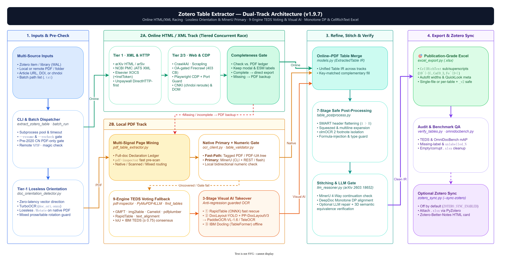
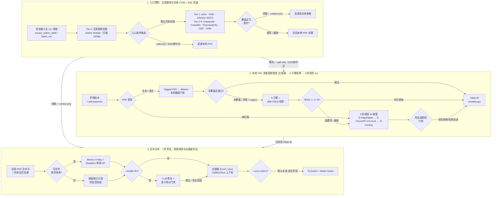

# 📊 Zotero Table Extractor

<p align="center">
  <a href="README.md">English</a> | <a href="README.zh-CN.md"><b>简体中文</b></a>
</p>

<p align="center">
  <b>一站式学术文献结构化表格智能提取系统</b><br/>
  从 Zotero 选中条目、本地/远程 PDF、学术期刊网页或 DOI 中自动定位、识别、核验并提取复杂科学表格，导出为出版级 Excel (<code>.xlsx</code>)。
</p>

<p align="center">
  <a href="#-核心能力"></a>
  <a href="#2-本地原生-pdf-主抽取9-引擎共识投票与-ibm-teds-仲裁"></a>
  <a href="#3-双轨无损方向自愈与-3-阶视觉-ai-接管"></a>
  <a href="#-环境要求与安装"></a>
  <a href="#-环境要求与安装"></a>
  <a href="LICENSE"></a>
</p>

<p align="center">
  <a href="#-架构设计与数据流转图"></a>
</p>

---

## 📑 目录

- [💡 项目简介](#-项目简介)
- [✨ 核心能力](#-核心能力)
  - [1. 在线 HTML/XML 高保真提取（分层并发竞速）](#1-在线-htmlxml-高保真提取分层并发竞速)
  - [2. 本地原生 PDF 主抽取、9 引擎共识投票与 IBM TEDS 仲裁](#2-本地原生-pdf-主抽取9-引擎共识投票与-ibm-teds-仲裁)
  - [3. 双轨无损方向自愈与 3 阶视觉 AI 接管](#3-双轨无损方向自愈与-3-阶视觉-ai-接管)
  - [4. 7 阶轻量安全后处理与 SMART 语义表头展平](#4-7-阶轻量安全后处理与-smart-语义表头展平)
  - [5. 跨页续表 MinerU 4-Way 判定与 DeepDoc 单调 DP 拼接](#5-跨页续表-mineru-4-way-判定与-deepdoc-单调-dp-拼接)
  - [6. OmniDocBench 标准化评测与 LLM 语义等价门禁](#6-omnidocbench-标准化评测与-llm-语义等价门禁)
  - [7. 出版级规范 Excel 导出（CellRichText 上下标保真）](#7-出版级规范-excel-导出cellrichtext-上下标保真)
  - [8. 全库批量并发与工业级鲁棒性](#8-全库批量并发与工业级鲁棒性)
  - [9. PyZotero 与 Zotero-Better-Notes 生态闭环联动（可选）](#9-pyzotero-与-zotero-better-notes-生态闭环联动可选)
- [🏗 架构设计与数据流转图](#-架构设计与数据流转图)
- [💻 环境要求与安装](#-环境要求与安装)
- [🔧 配置指南](#-配置指南)
  - [1. 跨平台路径与环境交互式配置向导 (`setup_paths.py`)](#1-跨平台路径与环境交互式配置向导-setup_pathspy)
  - [2. 配置文件手动初始化 (`config.json`)](#2-配置文件手动初始化-configjson)
  - [3. 环境变量与同伴凭据协同](#3-环境变量与同伴凭据协同)
  - [4. 详细配置项说明](#4-详细配置项说明)
  - [5. 常用 API 与 CLI 工具获取方式](#5-常用-api-与-cli-工具获取方式)
  - [6. 技能在线更新与配置防护机制 (`update.py`)](#6-技能在线更新与配置防护机制-updatepy)
  - [7. 期刊与知网登录向导 (`login.py`)](#7-期刊与知网登录向导-loginpy)
- [🚀 使用方法](#-使用方法)
  - [单篇 PDF 表格提取](#单篇-pdf-表格提取)
  - [在线文献 URL / DOI 提取](#在线文献-url--doi-提取)
  - [目录批量与路径清单批量提取](#目录批量与路径清单批量提取)
  - [Zotero 全库一键批量提取](#zotero-全库一键批量提取)
  - [结合 AI Agent / MCP 编排调用](#结合-ai-agent--mcp-编排调用)
  - [表格提取质量核验与清理](#表格提取质量核验与清理)
- [📂 文件结构](#-文件结构)
- [🧪 回归测试与评测范围](#-回归测试与评测范围)
- [🙏 鸣谢与参考开源项目](#-鸣谢与参考开源项目)
- [📄 开源协议与免责声明](#-开源协议与免责声明)

---

## 💡 项目简介

学术文献（尤其是地学、材料、化学、生物、医学等自然科学领域）中的表格往往存在**无边框/三线表、跨行跨列单元格、多数值挤压排版、上下标与正负公差、多级复合表头以及跨页续表（Continued tables）**等复杂排版特征。单一工具在面对上述排版时极易出现串行、漏列、表头坍缩或漏表问题。

**Zotero Table Extractor** 是一套端到端的学术表格智能提取与重构引擎：
1. **双轨驱动**：优先通过分层并发竞速（`race=True`）抓取 **arXiv HTML / ar5iv LaTeXML、NCBI PMC JATS XML、Elsevier XOCS XML**、各出版社 DOM、**CNKI**（含 `chndoi.org` 动态重路由）与 OA 门控 **Firecrawl / Scrapling / Crawl4AI / CDP Playwright**；若在线缺失或截断，无缝保留高保真在线表并由本地 PDF 管线补漏合并；
2. **无损方向校准与主抽取架构**：整合零时延矢量方向分析与 **TurboOCR (`doc_ori.onnx`)**，对旋转 Native PDF 无损重写 `/Rotate`；按「**Tagged PDF 结构树快速通道 → MinerU 结构化主抽取 (`mineru-open-api` CLI + REST + `flash-extract` + DoH 自愈) → 本地双向数值完整性门禁**」执行主抽取，未覆盖或开启传统模式时启用 **9 引擎投票与 IBM TEDS 拓扑仲裁**；
3. **3 阶视觉 AI 接管与离线兜底**：支持 **RapidTable (ONNX)** 快速挽救、**DocLayout-YOLO + PP-DocLayoutV3** 双检集成或 **PP-StructureV3** 切图送入 **PaddleOCR-VL-1.6 / TeleOCR (vLLM)**，以及 **IBM Docling (TableFormer)** 本地 CPU/Metal 离线接管；
4. **7 阶后处理、SMART 展平与单调 DP 拼接**：保留 MultiIndex、执行 **SMART 语义表头展平**（`Category > Subcategory > Field [Unit]`）、隔离 **olmOCR 2 风格尾注**、防御 Excel 公式注入，并以 **MinerU 4-Way 判定 + DeepDoc 单调 DP** 对齐合并跨页续表；
5. **语义等价门禁、富文本 Excel 与生态联动**：以 **LLM 语义等价性评测 (arXiv 2603.18652)** 把关大模型修复；借助 `openpyxl` `CellRichText` 高保真渲染 `10^{-3}`、`CaCO_3`、`Fe^{3+}` 等上下标；可选通过 PyZotero 挂载 `.xlsx` 并生成 **Zotero-Better-Notes** 预览笔记。

---

## ✨ 核心能力

### 1. 在线 HTML/XML 高保真提取（分层并发竞速）

- **权威全文数据源优先（含礼让窗口）**：
  - **arXiv HTML / ar5iv (LaTeXML)** 与 **NCBI PMC Open Access JATS XML**：免除 OCR 误差，完整保留 `rowspan`/`colspan` 与尾注；
  - **Elsevier XOCS XML**：支持 `X-ELS-APIKey` 与机构通行证 `X-ELS-InstToken`，自动反查 PII→DOI；
  - 并发竞速中若普通网页片段先到达而权威 XML 通道仍在拉取，自动授予有界礼让窗口（Grace Window）防止不完整网页抢先胜出。
- **广覆盖出版社 DOM 适配**：精细适配 **Wiley、Springer/Nature**（含 `idp.springer.com` 机构跳转恢复）、**Taylor & Francis**（含 CSV 下载）、**ACS、GeoSciWorld / Silverchair**（模态框展开与去重）、**MDPI、Copernicus XML、Frontiers、APS、IOP、OUP、Sage、De Gruyter、Science** 等。
- **中国知网 (CNKI) 专线与 2020 年前中文文献门控**：`ScraplingCNKI` ∥ `Crawl4AICNKI` 竞速后回退 `PlaywrightCNKI`（含拟人滑块验证与 `chndoi.org`/`chinadoi.cn` 动态重路由）；2020 年前中文文献自动直通本地 PDF 管线。
- **CDP 动态端口探测、Port Guard 与 6 槽位并发 (`cdp_detector.py`)**：
  - 自动探测 Chrome/Edge/Brave/Arc/Vivaldi 等 `DevToolsActivePort` 动态调试端口，内存复用校园网/CARSI 登录态；
  - **CDP Port Guard** 拦截页面对本地调试端口的反爬探测并伪装为 `ConnectionRefused`；
  - **跨进程 6 槽位文件锁** (`cdp_tab_slot_guard`) 支持多任务后台 Tab 安全并行抽取。
- **OA 门控与完备性核验**：`Firecrawl` 严格限定仅对已确认 OA 论文启用（含 `html`→`markdown` 回退与 403 熔断）；`Unpaywall` 采用 DirectHTTP 优先且跳过纯 PDF 链接；对在线结果比对 PDF 全文表号账本 (`Declaration Ledger`) 与扫描页线索，缺失时自动交由本地 PDF 补全并互补合并。

### 2. 本地原生 PDF 主抽取、9 引擎共识投票与 IBM TEDS 仲裁

- **多信号候选页挖掘**：扫描全文（无页数截断）汇总表号/续表声明账本、`pdf-inspector` (~5–80ms) 分类与 Markdown 表格、Tagged PDF 结构树、纯图/扫描页、分块自适应矢量 `find_tables()` + `find_tables(strategy="text")` + `probe_disjoint_native_tables()` 及 5 维跨页续表线索。
- **Native PDF 生产主抽取 (`v1.9.0`+)**:
  1. **Tagged PDF / PDF/UA 结构树快速通道**：全覆盖且通过数值门禁时直接采纳；
  2. **MinerU 官方结构化主抽取 (`ocr_client.py`)**：支持 `mineru-open-api` CLI 与 Python REST 双模调度 (`auto`/`cli`/`api`)、零 Token `flash-extract` / Agent API、AliDNS/Tencent DoH IP 旁路弹性重连 (`HostHeaderSSLAdapter`)、本地 `mineru_cache` ZIP/目录复用及 `page_ranges` 子集页码重映射；
  3. **本地双向数值完整性门禁 (`table_validator.py`)**：统一 `content_list` (0–1000) 与 `middle.json` (PDF 点坐标) 坐标系，校验提取数值与原生文本层一致性，杜绝截断或样本倒置。
- **9 引擎共识投票备用管线 (`three_way_vote` / `USE_LEGACY_VOTING=true`)**：
  - 汇集 **`pdf-inspector` (MD+结构树)、`PyMuPDF4LLM`、`PyMuPDF find_tables()`、`GMFT (TATR)`、`img2table`（纯 OpenCV 免 Ghostscript）、`Camelot` (Lattice/Stream)、`pdfplumber`、`RapidTable`、`text_alignment`（含 PDF-Extract-Kit 列聚类对齐）**；
  - 结合 2D bbox 重叠 (IoU/IoM)、防冲突表号聚类与纯 Python **IBM TEDS (`teds.py`)** 树编辑距离拓扑仲裁（$\ge 0.75$ 判定一致，$< 0.90$ 触发视觉 AI 复核）。

### 3. 双轨无损方向自愈与 3 阶视觉 AI 接管

- **Tier-1 双轨无损方向矫正 (`doc_orientation_detector.py`)**：融合零时延矢量文字方向与 **TurboOCR (`doc_ori.onnx`, ~6.47MB)**，带混排保护（0° 正文 + 90° 横表不误翻整页），对旋转 Native PDF 无损重写 `/Rotate`，仅对旋转纯扫描页执行 150 DPI 烘焙。
- **3 阶视觉 AI 与离线接管**：
  1. **阶段 1 — RapidTable 本地快速挽救**：`TableCls` 有线/无线分流 + `SLANet-Plus` (ONNX) / 可选 `UniTable` (PyTorch)；
  2. **阶段 2 — 本地版面集成 + 在线 VLM**：**DocLayout-YOLO (1280px ONNX) + PP-DocLayoutV3 (25 类多边形贴合)** 双检集成或 **PP-StructureV3** 切图 → **PaddleOCR-VL-1.6 / TeleOCR (vLLM)**（经由统一 `OCRBackendRegistry` 多云容灾调度，并执行 **Tier-2 切图正向旋转矫正**与防串表裁切边界隔离）；
  3. **阶段 3 — IBM Docling (TableFormer) 离线备用**：纯 CPU/Metal 本地运行（支持离线 HuggingFace 缓存探测），提供永不掉线的离线兜底。
- **防劣退质量门禁 (`_should_replace_with_ocr`)**：严禁行数萎缩或填充率低下的 OCR 结果替换有效原生表格。

### 4. 7 阶轻量安全后处理与 SMART 语义表头展平

1. **MultiIndex 直通保护与 LaTeX 清洗**：保留多层表头结构，规范化 `\pm`、`\times` 等符号；
2. **碎片表过滤**：拦截列数 $>30$ 且填充率 $<30\%$ 的误检碎片；
3. **表头探测与 SMART 语义展平**：自动识别科学表头并按 `Category > Subcategory > Field [Unit]` 展平多层复合表头且消解父子冗余词；
4. **挤压数值与多行展开**：拆分粘连数值、展开单元格内多行子项、向下填充地质层位/样品组别头；
5. **公式注入防御与类型推断**：保护 $>15$ 位长数值编号（防 IEEE 754 精度截断），对 `=`, `+`, `-`, `@` 开头内容前置 `'` 转义；
6. **噪声过滤与 olmOCR 2 尾注剥离**：移除付费墙/页眉页脚噪声，将 `* p < 0.05`、`Note:`、`注:` 等抽离至 `footnotes` 属性，同时保护 `NA`/`BDL`/`Na` 与编号数据行；
7. **表号与双语标题规范化**：统一 `Table 1`、`Table S1`、`表1` 等格式并保留完整中英文标题。

### 5. 跨页续表 MinerU 4-Way 判定与 DeepDoc 单调 DP 拼接

- **MinerU 4-Way 联合判定**：综合列名 Jaccard、页宽比对齐、表头一致性与续表词法 (`Table 1 (continued)`, `表1（续）`, `cont'd`, `续上表`)，开启 $<3$ 行小表保护；
- **DeepDoc / MinerU 3-Way 单调动态规划 (DP) 列对齐**：支持跨页列数增减时的严格保序对齐，以及横向分块表格（`Part 1` + `Part 2`）拼接；
- **不可对齐保护**：当重复行标识不足以证明横向对应关系时，保留独立片段，绝不按行号盲目拼接。

### 6. OmniDocBench 标准化评测与 LLM 语义等价门禁

- **OmniDocBench (CVPR 2025, `omnidocbench.py`)**：支持表格 TEDS、严格插值 PR 曲线 mAP (`IoU@0.50/0.75/0.50:0.95`) 与端到端召回率评测；
- **LLM 智能重构与语义等价门禁 (`llm_reasoner.py`, arXiv 2603.18652)**：支持 OpenAI 兼容 API、**免 Key 本地端点的 Ollama/vLLM/LMDeploy/SGLang** 以及 Agent Bridge；每次表格重构均须通过内容完整性、表头语义保真度与行元组一致性三维度验收。

### 7. 出版级规范 Excel 导出（`CellRichText` 上下标保真）

- **`openpyxl` `CellRichText` 学术富文本**：原位呈现 `10^{-3}`、`CaCO_3`、`H_2O`、`Fe^{3+}` 等上下标，同时保持纯数值单元格的可计算性；
- **排版与元数据**：深色加粗表头、交替斑马纹、前 200 行自适应列宽、Dublin Core 属性（支持 macOS QuickLook 空格即时预览）、单表独立或 `--single-file` 多 Sheet 输出，以及 `_v2`/`_v3` 防撞原子写入。

### 8. 全库批量并发与工业级鲁棒性

- **WAL 安全 SQLite 快照**：连同 `-wal`/`-shm` 克隆临时快照，彻底规避 Zotero 运行时 `database is locked`；
- **预分析与子进程隔离 (`batch_planner.py` + `batch_run.py`)**：预解析 DOI/出版社/年份，以独立子进程并发处理每篇文献，支持超时熔断、`--resume` 断点续传与 `--recheck` 表号覆盖率复检。

### 9. PyZotero 与 Zotero-Better-Notes 生态闭环联动（可选）

- **默认严格关闭 (`ZOTERO_SYNC_ENABLED=false`)**：按需通过配置或 `--sync-zotero` 开启；
- **自动挂载与笔记卡片 (`zotero_sync.py`)**：反向溯源条目 Key，通过 PyZotero 将 `.xlsx` 挂载为子附件，并生成 `📊 Extracted Tables (N tables)` Better-Notes 富文本预览笔记（离线同步生成 `_better_notes.html` 本地快照）。

---

## 🏗 架构设计与数据流转图



> **可编辑矢量架构图源文件**：由 `scripts/export_drawio_diagram.py` 维护并导出至 `figures/`：
> - 📄 [figures/zotero_table_extractor_architecture.drawio](figures/zotero_table_extractor_architecture.drawio)
> - 🖼 [figures/zotero_table_extractor_architecture.svg](figures/zotero_table_extractor_architecture.svg)
> - 🖼 [figures/zotero_table_extractor_architecture.png](figures/zotero_table_extractor_architecture.png)

---

## 💻 环境要求与安装

### 1. 基础环境
- **操作系统**：macOS (Apple Silicon / Intel)、Linux、Windows 10/11
- **Python 版本**：Python 3.9 及以上（推荐 Python 3.10 或 3.11）
- **包管理器**：推荐使用 [uv](https://github.com/astral-sh/uv) 或 `pip`

### 2. 系统底层依赖（可选）
如需启用 `Camelot` 或 Tesseract 备用识别（`img2table` 为纯 Python + OpenCV，免 Ghostscript）：
- **macOS**：`brew install ghostscript tesseract`
- **Ubuntu / Debian**：`sudo apt update && sudo apt install -y ghostscript libgl1-mesa-glx tesseract-ocr`
- **Windows**：安装 [Ghostscript](https://ghostscript.com/releases/gsdnld.html) 并将其 `bin` 目录加入系统 `PATH`。

### 3. 安装 Python 依赖

```bash
git clone https://github.com/ZRyanX/zotero-table-extractor.git
cd zotero-table-extractor

uv pip install -r requirements.txt
# 或使用 pip
pip install -r requirements.txt
```

`requirements.txt` 中还列出了可选增强包（`gmft`、`img2table`、`pymupdf4llm`、`rapid-table`、`rapidocr`、`table-structure-rec`、`pyzotero`、`scrapling`、`crawl4ai`），未安装时运行期会自动平滑降级。

### 4. 安装 Playwright 浏览器内核（用于动态期刊渲染）
```bash
playwright install chromium
```

### 5. 本地视觉与方向 ONNX 模型准备
仓库内置 `models/doclayout_yolo_docstructbench_imgsz1280_2501.onnx` 与 `models/doc_ori.onnx`，也可随时执行以下命令校验或按需下载补齐：
```bash
python setup_paths.py --download-models
```

---

## 🔧 配置指南

### 1. 跨平台路径与环境交互式配置向导 (`setup_paths.py`)

```bash
python setup_paths.py            # 交互式引导配置（推荐）
python setup_paths.py --auto     # 非交互式一键自动探测并保存推荐路径
python setup_paths.py --show     # 查看当前路径配置与有效性状态
python setup_paths.py --reset    # 预备份后重置 config.json 为官方模板
```

### 2. 配置文件手动初始化 (`config.json`)

```bash
cp config.example.json config.json
```

> [!IMPORTANT]
> **隐私与安全保护**：`config.json` 与 `profiles/` 受 `.gitignore` 保护，且被 `update.py` 与 `scripts/package_release.py` 严格拦截，严禁提交入库。

### 3. 环境变量与同伴凭据协同

支持通过环境变量注入关键配置并覆盖 `config.json`（如 `PAPER_TABLES_DIR`、`ZOTERO_DIR`、`ELSEVIER_API_KEY`、`ELSEVIER_INSTTOKEN`、`IS_CAMPUS_NETWORK`、`UNPAYWALL_EMAIL`、`CROSSREF_EMAIL`、`OPENALEX_API_KEY`、`CORE_API_KEY`、`FIRECRAWL_API_KEY`、`PADDLEOCR_ACCESS_TOKEN`、`PADDLEOCR_MCP_AISTUDIO_ACCESS_TOKEN`、`MINERU_TOKEN`、`MINERU_API_KEY`、`MINERU_AGENT_BACKEND`、`MINERU_POLL_TIMEOUT`、`MINERU_TABLE_MERGE_ENABLE`、`OCR_ENGINE`、`TELEOCR_API_BASE`、`TELEOCR_MODEL`、`TELEOCR_API_KEY`、`DOCLAYOUT_ENGINE`、`OPENAI_API_KEY`、`LLM_API_KEY`、`LLM_API_BASE`、`LLM_TABLE_REASONER_ENABLED`、`ZOTERO_SYNC_ENABLED` 等）。

当主配置与环境变量留空时，`scripts/common.py` 会自动安全读取同生态同伴工具配置（`~/.scansci-pdf/config.json`、`~/.journal_supp_downloader_profile/config.json`、`journal-supp-downloader/.env`），也可设置 `ZTE_DISABLE_COMPANION_CREDS=1` 禁用该协同回退。此外还支持运行时微调开关：`USE_LEGACY_VOTING=true`、`USE_DOC_ORIENTATION_CLASSIFY`、`ZOTERO_ATTACHMENTS_BASE_DIR`、`RAPID_TABLE_UNITABLE=0`、`AGENT_BRIDGE_DIR`。

### 4. 详细配置项说明

完整 74 项 `config.json` 配置键说明请参阅 [SKILL.md 配置项章节](SKILL.md#配置项configjson)（涵盖 MinerU CLI/REST、TeleOCR、PP-DocLayoutV3、RapidTable、Docling、Elsevier InstToken、Polite Pool 邮箱、OmniDocBench、SMART 展平及 Zotero 联动全部参数）。

### 5. 常用 API 与 CLI 工具获取方式

- **MinerU API Token 与 Open API CLI（推荐）**：在 [MinerU 平台](https://mineru.net/) 获取 Token，可选全局安装官方 CLI：
  ```bash
  npm install -g mineru-open-api
  # 或 Go:
  go install github.com/opendatalab/MinerU-Ecosystem/cli/mineru-open-api@latest
  mineru-open-api auth
  ```
- **百度飞桨 AIStudio Access Token**：在 [AIStudio](https://aistudio.baidu.com/) 个人中心创建令牌，用于调度 `PP-StructureV3` 与 `PaddleOCR-VL-1.6`。
- **TeleOCR（可选 VLM 端点）**：配置 `TELEOCR_API_BASE`、`TELEOCR_MODEL` 及可选 `TELEOCR_API_KEY`，以启用自托管 vLLM / OpenAI 兼容视觉推理端点。
- **LLM 端点（可选，用于 `--enable-llm`）**：配置 `OPENAI_API_KEY`（或 `LLM_API_KEY`）与 `LLM_API_BASE`（默认 `"https://api.openai.com/v1"`，本地部署 OpenAI 兼容服务如 Ollama / vLLM 的 `localhost` 端点无需 API Key 即可运行）。
- **Elsevier Developer Portal**：在 [dev.elsevier.com](https://dev.elsevier.com/) 申请 `ELSEVIER_API_KEY`（机构用户可配合 `ELSEVIER_INSTTOKEN`）。
- **Firecrawl（可选）**：在 [firecrawl.dev](https://www.firecrawl.dev/) 获取 Key，仅用于 OA 文献备用抽取。

### 6. 技能在线更新与配置防护机制 (`update.py`)

```bash
python update.py                 # 一键在线安全更新（Git / Release 双模，零覆盖个人配置与密钥）
python update.py --check         # 只读检测远端更新与新增配置项
python update.py --dry-run       # 模拟更新全流程，不写入磁盘
python update.py --rollback      # 一键回滚至最近一次配置快照
python update.py --list-backups  # 查看历史配置快照清单
python update.py --merge-only    # 仅安全合并 config.example.json 新增配置项
python update.py --check --json  # 结构化 JSON 输出
```

### 7. 期刊与知网登录向导 (`login.py`)

```bash
python scripts/login.py cnki        # 知网交互式登录与 Cookies 捕获
python scripts/login.py publishers  # 国际出版社 Chrome CDP 调试桥接登录
python scripts/login.py crawl4ai    # Crawl4AI 免检测登录与 Cookie 导出
```

---

## 🚀 使用方法

### 单篇 PDF 表格提取

```bash
# 导出分表 .xlsx + table_captions.txt
python scripts/extract_zotero_table.py --pdf "/path/to/paper.pdf" --output "/path/to/output_dir"

# 导出单文件多 Sheet，并开启 LLM 复杂表头修复与语义等价门禁
python scripts/extract_zotero_table.py --pdf "/path/to/paper.pdf" --output "/path/to/tables.xlsx" --single-file --enable-llm

# 跳过出版社网页抓取（直接进入 PDF 提取管线）
python scripts/extract_zotero_table.py --pdf "/path/to/paper.pdf" --output "/path/to/output_dir" --pdf-only

# 仅在线 HTML/XML 抓取，不回退本地 PDF
python scripts/extract_zotero_table.py --pdf "/path/to/paper.pdf" --output "/path/to/output_dir" --online-only

# 指定 OCR 引擎、串行在线诊断模式，并自动同步回 Zotero
python scripts/extract_zotero_table.py --pdf "/path/to/paper.pdf" --output "/path/to/output_dir" --ocr-engine mineru --sequential --sync-zotero
```

### 在线文献 URL / DOI 提取

```bash
python scripts/extract_zotero_table.py --pdf "https://doi.org/10.1016/j.precamres.2021.106450" --output "./output"
python scripts/extract_zotero_table.py --pdf "https://link.springer.com/article/10.1007/s00126-020-00994-x" --output "./output"
```

### 目录批量与路径清单批量提取

```bash
python scripts/extract_zotero_table.py --pdf "/path/to/pdf_folder" --output "/path/to/output_base" --workers 4
python scripts/extract_zotero_table.py --pdf "paper_list.txt" --output "/path/to/output_base" --workers 4
```

### Zotero 全库一键批量提取

```bash
python scripts/batch_run.py --db-path "~/Zotero/zotero.sqlite" --paper-tables "~/paper_tables" --workers 4 --resume

# 核验已有产出文件夹的表号覆盖率，自动重跑遗漏文献
python scripts/batch_run.py --recheck --workers 2
```

### 结合 AI Agent / MCP 编排调用

在 Cursor、Claude Desktop、Antigravity 中，上层 Agent 通过 `ai4paper-zotero` MCP（`zotero_get_selected_items`）获取选中条目的物理 PDF 路径后直接调度：
```bash
python scripts/extract_zotero_table.py --pdf "<Zotero物理路径>" --output "<目标路径>"
```

### 表格提取质量核验与清理

```bash
python scripts/verify_tables.py --root "/path/to/output_dir" [--fix] [--verbose]
```

---

## 📂 文件结构

完整目录结构与模块职责清单请参阅 [SKILL.md 技能目录结构](SKILL.md#技能目录结构)。

---

## 🧪 回归测试与评测范围

- **离线回归验证**：使用 `python tests/run_offline.py`（可选 `--pattern test_*.py`）在临时隔离副本中运行回归测试，不复制个人 `config.json`，阻断外网与外部服务进程；真实浏览器测试默认跳过，需显式设置 `ZOTERO_RUN_LIVE_BROWSER=1`。
- **基准评测口径 (`benchmarks/run_benchmark.py`)**：
  ```bash
  python benchmarks/run_benchmark.py --pipelines p1,p2,p3 --groups A,B,C,D,E --mineru-mode fixture
  ```
  - `--mineru-mode fixture`（默认）使用由标准答案生成的模拟缓存，仅验证解析、质量检查与续表后处理，不得将 `fixture` 模式的准确率或耗时当作真实模型识别效果或服务加速倍数；
  - `--mineru-mode live` 会提交 PDF 至 MinerU 并忽略模拟缓存；
  - `--pdf-only` 仅跳过出版社网页抓取，PDF 管线内部仍可能按配置调用 `MinerU` / `PaddleOCR-VL` / `TeleOCR` 等云端服务。

---

## 🙏 鸣谢与参考开源项目

感谢以下卓越开源项目对本项目的启发与赋能：
[PaddleOCR (PP-StructureV3 / PP-DocLayoutV3 / PaddleOCR-VL)](https://github.com/PaddlePaddle/PaddleOCR)、[MinerU](https://github.com/opendatalab/MinerU)、[DocLayout-YOLO](https://github.com/opendatalab/DocLayout-YOLO)、[zotero-figure](https://github.com/MuiseDestiny/zotero-figure)、[IBM Docling (TableFormer)](https://github.com/DS4SD/docling)、[RapidAI TableStructureRec & RapidTable](https://github.com/RapidAI/TableStructureRec)、[pdf-inspector](https://github.com/firecrawl/pdf-inspector)、[PyMuPDF & PyMuPDF4LLM](https://github.com/pymupdf/PyMuPDF4LLM)、[GMFT](https://github.com/conjuncts/gmft)、[img2table](https://github.com/xavctn/img2table)、[pdfplumber](https://github.com/jsvine/pdfplumber)、[Camelot](https://github.com/camelot-dev/camelot)、[IBM PubTabNet (TEDS)](https://github.com/ibm-aur-nlp/PubTabNet)、[OmniDocBench](https://github.com/opendatalab/OmniDocBench)、[RAGFlow DeepDoc](https://github.com/infiniflow/ragflow)、[Playwright](https://github.com/microsoft/playwright-python)、[Scrapling](https://github.com/D4Vinci/Scrapling)、[Crawl4AI](https://github.com/unclecode/crawl4ai)、[Firecrawl](https://github.com/mendableai/firecrawl)、[openpyxl](https://foss.heptapod.net/openpyxl/openpyxl)、[pyzotero](https://github.com/urschrei/pyzotero) 与 [zotero-better-notes](https://github.com/windingwind/zotero-better-notes)。

---

## 📄 开源协议与免责声明

- **开源协议**：基于 [Apache License 2.0](LICENSE) 协议开源。
- **免责声明**：本项目仅供学术研究与个人文献整理使用；使用在线抓取或 API 时请遵守各出版社条款、`robots.txt` 与机构授权规范，并妥善保管个人密钥与会话文件。
